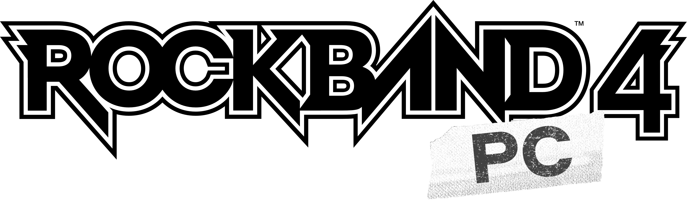

<p align="center">
  
</p>

# RB4PC

RB4PC is an experimental, clean-room effort to build independent PC tooling and
runtime components compatible with assets supplied by users from their own
legally obtained copy of Rock Band 4.

The repository does **not** contain game executables, songs, ARK/HDR archives,
console libraries, or other proprietary game content. Do not add those files to
the repository.

## Builder GUI preview

The Windows build includes `rb4pc-builder-gui.exe`, an early native interface
for the Builder. Its file and folder actions load only PC-named ForgeTool output
(`_pc` files, PC HDR sets, and their PC ARK volumes); `_ps4` inputs are blocked.
PC HDR files also undergo version-10 and hash-index validation before they are
accepted. The GUI links to the existing inspection tools and retains placeholders
for future conversion and repair workflows. Maximizing the window keeps the same
button dimensions as windowed mode and centers the controls. This preview was
introduced in v0.160.0; it does not represent a 1.0.0 release or claim that the
full game
conversion is complete.

## Current milestone: v0.520.0 Bounded Metadata Offset Candidates

Version 0.520.0 extends metadata schema version 7 with nonzero, in-record, and
four-byte-aligned value measurements. Strict `boundedOffset` candidate lists
identify fields whose every observation remains inside its own record without
claiming that those values are decoded pointers or references.

## v0.500.0 Metadata Cohort Evidence

Version 0.500.0 makes cross-HDR metadata evidence part of the complete PC corpus
audit contract. Metadata schema version 6 measures family coverage per HDR,
field stability across HDRs, and mutually exclusive evidence classes. Corpus
summary schema version 4 requires every profiled field to be classified before
an audit can report `complete: true`. The CLI and GUI expose the invariant.

## v0.480.0 Integrated Evidence Status

Version 0.480.0 added profiled/classified field totals and the explicit
`evidenceClassificationComplete` invariant to the metadata catalog, combined
audit, CLI, and Windows Builder.

## v0.460.0 Metadata Evidence Classes

Version 0.460.0 classified each aligned metadata word as cross-HDR constant,
per-HDR constant with differing values, variable between records, or incomplete
across the HDR cohort without assigning speculative semantic names.

## v0.440.0 Cross-HDR Field Stability

Version 0.440.0 began measuring whether aligned words are present and constant
within and across independent HDR sets.

## v0.420.0 Metadata HDR Cohort Coverage

Version 0.420.0 added privacy-preserving per-family HDR coverage and per-HDR
record-count ranges without publishing filenames or internal paths.

## v0.400.0 Consistent Complete Corpus Audit

Version 0.400.0 consolidates the four PC catalog families into one verified,
read-only audit contract. Summary schema version 2 records whether asset, audio,
character/animation, and metadata passes observed identical candidate and valid
HDR counts. The CLI and GUI expose that result, metadata totals, and the complete
five-file output set.

## v0.380.0 Metadata Field Candidates

Version 0.380.0 upgrades the metadata catalog to schema version 2 with aligned
32-bit profiles and explicit constant, record-size, and remaining-size candidate
offsets. These are evidence for later decoding, not asserted field semantics.

## v0.360.0 GUI Metadata Catalog

Version 0.360.0 adds `Tools > PC Metadata Catalog...` to the Windows Builder.
The workflow accepts one `*_pc.hdr` or a folder, generates the bounded metadata
catalog, and writes it to a user-selected JSON destination.

## v0.340.0 Metadata-Aware Corpus Audit

Version 0.340.0 integrates the native PC metadata catalog into the combined
audit. Every successful audit now publishes five reports: `summary.json`,
`assets.json`, `audio.json`, `characters.json`, and `metadata.json`. Completion
requires the metadata scan to finish without invalid HDRs or unreadable records.

## v0.320.0 PC Metadata Structure Catalog

Version 0.320.0 begins the next porting boundary with a dedicated read-only
catalog for `.rbsong`, `.songdta_pc`, `.moggsong_dta_pc`, `.csv_pc`, and `.dta`
records inside user-supplied PC HDR/ARK sets:

```text
rb4pc-builder <hdr-or-directory> --catalog-pc-metadata <catalog.json>
```

The schema reports aggregate sizes, bounded binary prefixes, first 32-bit values,
and privacy-preserving ASCII-run statistics without recording discovered strings
or internal paths. See
[`docs/pc-metadata-catalog.md`](docs/pc-metadata-catalog.md).

## v0.300.0 Complete PC Corpus Audit

Version 0.300.0 completes the first unified read-only audit workflow for
user-supplied PC/Rock Band VR HDR/ARK sets. The CLI and Windows Builder GUI now
produce a four-file audit bundle with an aggregate summary plus asset, audio,
and character/animation reports:

```text
rb4pc-builder <hdr-or-directory> --audit-pc-corpus <new-output-directory>
```

Publication is transactional: files are written to a temporary sibling and the
finished directory is moved into place only after every JSON is complete.
Existing destinations are never overwritten.

The real intermediate milestones were v0.220.0 for the GUI asset catalog,
v0.240.0 for the GUI audio audit, and v0.270.0 for the combined core/CLI audit.
The project now follows the documented rule that large objectives are divided
into testable milestones rather than advancing version numbers prematurely.
See [`docs/pc-corpus-audit.md`](docs/pc-corpus-audit.md) and
[`docs/version-policy.md`](docs/version-policy.md).

## v0.200.0 GUI Structural Catalog

Version 0.200.0 connects the character/animation structural catalog directly
to the Windows Builder GUI. `Tools > Character/Animation Inventory...` accepts
one validated `*_pc.hdr` or a PC folder, then writes the aggregate JSON report
to a user-selected destination. PS4 inputs remain outside this workflow.

Version 0.190.0 added privacy-preserving ASCII signals from the first 256 bytes:
counts and length distributions only, never the discovered strings themselves.
Version 0.180.0 added explicit constant, record-size, and remaining-size field
candidates. The catalog schema is now version 4.

## v0.170.0 Character Structure Profile

Version 0.170.0 extends the character and animation catalog from a four-byte
inventory to a bounded 64-byte structural profile. For each aligned 32-bit word
it records observations, distinct and zero values, minimum and maximum values,
and correlations with the full or remaining record size:

```text
rb4pc-builder <hdr-or-directory> --catalog-pc-characters <catalog.json>
```

The schema is now version 2. The measurements identify reproducible candidates
for versions, sizes, flags, and references without claiming unverified field
semantics or copying proprietary payloads into the repository.

Version 0.160.0 introduced the native character and animation inventory.

Version 0.160.0 inventories native character and animation records directly
inside PC HDR/ARK sets:

```text
rb4pc-builder <hdr-or-directory> --catalog-pc-characters <catalog.json>
```

The catalog groups character definitions, animations, clips, skeletons, bone
masks, and stances. For each family it reports counts, total/minimum/maximum
sizes, raw first-four-byte distributions, and their little-endian 32-bit value.

Across the user-owned RBVR corpus it found 3,484 records representing
671,475,650 bytes with zero empty or unreadable records. Every family had one
consistent observed prefix: charanim and bonemask `0x11`, charclip and skeleton
`0x01`, character `0x0d`, and stance `0x00`. These values are candidates for
version fields, not yet claimed semantics.

Version 0.150.0 introduced the native PC audio audit.

Version 0.150.0 inspects audio records directly inside one HDR/ARK set or an
entire PC corpus without extracting them:

```text
rb4pc-builder <hdr-or-directory> --catalog-pc-audio <catalog.json>
```

The audit validates MOGG headers and embedded `OggS`, RIFF/WAVE records, and
RIFF/FEV banks. It separately counts opaque audio, unreadable records, missing
signatures, and MOGGs with unsupported or potentially protected headers.

Across the user-owned RBVR corpus it inspected 4,806 audio records representing
3,981,520,152 bytes. Results: 1,640 version-10 MOGGs with valid embedded Ogg,
98 unsupported/protected MOGG headers, 3,051 valid RIFF/WAVE records, 13 valid
RIFF/FEV banks, three `.wav` records without RIFF, one opaque noise asset, and
zero unreadable records.

Version 0.130.0 introduced the native PC asset catalog.

Version 0.130.0 adds a reproducible catalog across one HDR or a directory tree
of PC/Rock Band VR archive sets:

```text
rb4pc-builder <hdr-or-directory> --catalog-pc-assets <catalog.json>
```

The schema records valid and invalid headers, volume and record totals, declared
payload bytes, top-level namespaces, normalized extension families, asset
categories, and paths that are native, RB4PC-intermediate, or still unknown.
Compound FBX mesh object names are normalized into one family rather than
misreported as thousands of extensions.

The local user-owned RBVR corpus validated 23 HDRs, 27 ARK volumes, 35,582
records, and 8,338,130,919 declared payload bytes. All paths were assigned to
12 evidence-based categories: chart, audio, scene/rendering, texture,
character/animation, metadata, lipsync, script, performance pattern, UI, marker,
and video. Recognition describes the path family only; it does not claim the
binary payload has already been decoded or can be generated by RB4PC.

Version 0.110.0 introduced bounded multi-volume PC archives.

Version 0.110.0 extends the deterministic writer to any number of bounded ARK
volumes. The optional final argument sets the maximum bytes per volume:

```text
rb4pc-builder <song-directory> --build-pc-archive <output-dir> <shortname> [max-ark-bytes]
```

Records remain whole: a payload that does not fit in the current volume starts
the next `_pc_N.ark`, and a payload larger than the configured limit is rejected.
The HDR records every ordered name and exact size while retaining global
concatenated offsets. After publication the complete set is mounted again and
every record must resolve inside exactly one verified volume.

The real external validation corpus produced three ARKs of 114,096, 15,165,041,
and 45,080 bytes. All six records resolved at their expected volume boundaries.

Version 0.101.0 introduced the first deterministic single-volume writer.

It added the first write path toward the complete port. The Builder
can package a validated song directory into a deterministic version-10
`<shortname>_pc.hdr` and `<shortname>_pc_0.ark` pair:

```text
rb4pc-builder <song-directory> --build-pc-archive <output-dir> <shortname>
```

The ARK concatenates payloads under `pc/songs_download/<shortname>/`. The HDR
records their offsets and sizes, uses the verified encrypted byte stream, and
builds the complete Murmur hash index. The Builder reopens the HDR and verifies
the generated structure before publishing either destination. Existing files,
symbolic links, unsafe names, and values beyond the v10 limits are rejected.

Identical input produces identical HDR and ARK hashes. This milestone proves
the PC container-writing boundary; it does not yet claim that every payload
inside the archive is in the native format expected by Rock Band VR.

Version 0.100.0 marked the first end-to-end validated release of the clean-room
custom-song runtime. Using only user-supplied files outside the repository, the
release workflow has assembled a song directory, converted supported PS4
artwork, verified every manifest hash, decoded an entire multichannel MOGG, and
completed deterministic five-fret gameplay and audio transport. The exact
validation procedure and current compatibility boundary are recorded in
[`docs/release-validation.md`](docs/release-validation.md).

This milestone is not a native PC port of the proprietary Rock Band 4
executable. It is an independent runtime for compatible, user-supplied assets.
Standard MIDI charts are supported; direct gameplay decoding of PS4 RBMID files
remains future work.

The v1.0.0 milestone is reserved for a substantially complete PC port,
including PC-format HDR/ARK generation compatible with the asset organization
used by Rock Band VR and the runtime required to use those converted assets.
The current milestone does not make that claim.

The builder can now assemble a conventional `songs/<shortname>/` directory from
validated MIDI, MOGG, mix metadata, and a supported PS4 artwork texture. Artwork
is converted to `<shortname>.png_pc`, accompanied by its conversion manifest,
and both files are recorded with SHA-256 hashes in schema version 2 of
`session.json`:

```text
rb4pc-builder --assemble-song-with-art <notes.mid> <song.mogg> <song.mogg.dta> <art.png_ps4> <output-root> <shortname>
```

The runtime accepts legacy manifests and schema version 1 core-song manifests.
For schema version 2 it requires a complete artwork block, the canonical
filenames, both files, and matching hashes before exposing the song directory.
The song browser now decodes the selected song's validated BC1/BC3 artwork and
renders it directly into the software framebuffer, with the previous layout as
a fallback for songs without artwork.

Windows builds now embed the selected RB4PC repository icon in every generated
executable. The source artwork remains in `assets/branding`, while the generated
multi-purpose Windows resource is tracked in `assets/windows` for reproducible
CMake builds. Window titles also report the current project version.

The launcher now opens `./songs` when no directory argument is supplied. Keyboard
input works alongside XInput: Up/Down navigate and strum, Enter confirms, Escape
cancels, P pauses, and 1–5 map to the five fret lanes. A controller can connect
or disconnect without disabling the keyboard fallback.

The release preset builds and tests an optimized configuration, then packages
the launcher, builder, essential song tools, documentation, branding, and an
empty `songs/` directory into a platform-and-architecture-labelled ZIP:

```powershell
cmake --preset release
cmake --build --preset release
ctest --preset release
cpack --preset release
```

The software framebuffer now includes an original 5x7 bitmap text renderer.
The launcher displays a title, song short names, invalid-entry labels, and
keyboard/controller actions without relying on proprietary fonts or textures.

`rb4pc.ini` persists the master volume and gameplay latency compensation. The
launcher creates defaults when the file is missing, rejects unknown or unsafe
values, applies volume to the live MOGG mixer, applies latency to chart timing,
and displays both active values during gameplay.

The probe can now scan a directory recursively and group supported containers
by magic, platform version, base dimensions, flags, mipmap count, marker, and
stored bits per pixel. Unsupported signatures are counted rather than silently
discarded:

```text
rb4pc-texture-probe --scan <directory> <extension>
```

Magic-3/version-7 and magic-3/version-8 containers are now parsed without
guessing platform-specific mipmap boundaries. Their dimensions and flags are
reported per level, while the aligned/swizzled storage is preserved as one
opaque payload with an exact offset, size, and SHA-256.

The probe can now convert the proven linear PS4 family—magic 6/version 12,
256x256, seven mipmaps, and 4 or 8 stored bits per pixel—to the canonical PC
magic-6/version-9 container:

```text
rb4pc-texture-probe --convert-pc <source.png_ps4> <destination.png_pc>
```

The operation preserves every mipmap and the footer, writes a hash manifest,
refuses unsupported families or existing destinations, and reopens the result
before success. Generated 4bpp and 8bpp samples were also accepted by
LibForge's independent `TextureReader`.

The first executable is `rb4pc-forge-inspector`, a read-only tool for recording
verifiable properties of candidate files. It reports the file size, SHA-256,
first 32 bytes, a filename-derived platform hint, and the ordered ARK volumes
associated with an HDR file. Format parsing will only be added as findings are
tested and documented.

The report also records Shannon entropy globally and per 64 KiB block, zero-byte
counts, and exactly repeated full blocks. These measurements describe byte
distributions; they do not by themselves prove compression or encryption.

Version 10 HDR files are decoded with the verified Park-Miller XOR stream. The
report lists every ARK declared by the header—including patch volumes—and checks
each declared size against the local file without modifying game data.

The decoder also reads per-archive tags and the complete internal file-record
table. Version 0.2.2 also decodes and validates the final path-hash bucket table
and each record's collision-chain link.

Version 0.3.0 begins read-only ARK access by translating each record's global
offset into a declared volume index and a local offset. A record is resolved
only when its complete byte range stays inside one volume; cross-volume and
out-of-range spans are rejected.

Version 0.3.1 adds the optional payload catalog. It samples at most 16 bytes
from each non-empty record, groups internal filename extensions, recognizes a
small set of established magic values, and retains representative paths for
each signature group. Short zlib and gzip matches are labeled as candidates
rather than treated as proof of compression.

## Build

Requirements:

- CMake 3.25 or newer
- A C++20 compiler
- Ninja when using the included preset

```powershell
cmake --preset default
cmake --build --preset default
ctest --preset default
```

Run the inspector against a file stored outside this repository:

```powershell
./build/default/rb4pc-forge-inspector.exe "../path/to/main_ps4.hdr" --output report-ps4.json
```

Look up an exact internal path through the HDR hash index and read a bounded
32-byte preview directly from its ARK volume:

```powershell
./build/default/rb4pc-forge-inspector.exe "../path/to/main_ps4.hdr" --find "path/inside/archive"
```

This operation is read-only. It does not extract the complete record or alter
the user's HDR/ARK files.

Catalog extensions and recognized payload signatures using a maximum 16-byte
sample from each non-empty record:

```powershell
./build/default/rb4pc-forge-inspector.exe "../path/to/main_ps4.hdr" --catalog
```

Unknown signatures remain explicitly labeled `unknown`; the tool does not infer
compression or a file type solely from an internal filename extension.

Extract one exact internal path to an explicit new destination:

```powershell
./build/default/rb4pc-forge-inspector.exe "../path/to/main_ps4.hdr" `
  --extract "path/inside/archive" --destination "./output.bin"
```

The extractor refuses to overwrite an existing destination, copies through a
temporary file, validates the record against the actual ARK size, and reports
the extracted size and SHA-256. The internal path is never used as a host
filesystem destination.

Extract a filtered set while preserving its safe internal hierarchy:

```powershell
./build/default/rb4pc-forge-inspector.exe "../path/to/main_ps4.hdr" `
  --extract-prefix "songs/example/" --extract-extension ".mogg" `
  --destination-dir "./selected-assets"
```

Prefix and extension filters may be used separately or together. Zero-size
markers are excluded. The destination directory must not already exist, and
the completed directory contains `rb4pc-manifest.json` with each internal path,
relative output path, size, and SHA-256. Absolute paths, drive-qualified names,
empty components, `.` and `..` components are rejected.

Version 0.4.0 begins structural parsing of payload formats with RIFF. During
`--catalog`, every RIFF record's logical size is compared with its HDR record
size and its top-level chunk table is walked with alignment and boundary
validation. Reports include valid/invalid counts, form types, chunk identifiers,
and whether any trailing allocation region is zero or nonzero.

Version 0.4.1 decodes the standard 16-byte prefix of each WAVE `fmt ` chunk and
catalogs format tags, channel counts, sample rates, block alignment, byte rates,
and bits per sample without decoding or playing the audio payload.

Version 0.4.2 records the first two little-endian 32-bit values in each FEV
`FMT ` chunk and compares their distributions across platforms. Their semantics
remain explicitly unknown until corroborated by additional evidence.

Version 0.5.0 adds the first asset conversion operation. `--convert-riff`
exports the structurally validated logical RIFF range to a new file. If the HDR
record contains trailing bytes, they are preserved in an adjacent
`.rb4pc-trailing.bin` sidecar with a separate SHA-256 instead of being silently
discarded.

```powershell
./build/default/rb4pc-forge-inspector.exe "../path/to/main_ps4.hdr" `
  --convert-riff "path/inside/archive.wav" --destination "./converted.wav"
```

The destination and any sidecar must not already exist. Conversion is read-only
with respect to the user's HDR/ARK source files.

Version 0.5.1 re-parses every converted RIFF before reporting success and emits
an adjacent `.rb4pc-conversion.json` manifest containing the internal source
path, form type, logical and record sizes, output hash, and optional sidecar hash.

Version 0.6.0 introduces `rb4pc-builder` as a separate executable. Its first
operation is deliberately non-destructive: it validates HDR version 10, the
path hash index, ARK presence and usable sizes, and complete record addressing,
then writes a versioned JSON conversion plan. It does not yet build a runtime or
copy proprietary assets.

```powershell
./build/default/rb4pc-builder.exe "../path/to/main_ps4.hdr" --plan "./build-plan.json"
```

Version 0.6.1 adds a conversion inventory to the plan: structurally validated
RIFF records and their `WAVE`/`FEV ` split. This measures currently supported
work without implying that unknown formats are convertible.

Version 0.7.0 introduces a runtime-facing virtual file system over the user's
HDR/ARK set. It resolves exact internal paths through the verified hash index,
reports logical record sizes, and performs bounded range reads without prior
extraction. `rb4pc-runtime-probe` mounts a set and reads a 32-byte preview.

```powershell
./build/default/rb4pc-runtime-probe.exe "../path/to/main_ps4.hdr" "path/inside/archive"
```

Version 0.7.1 adds bounded prefix enumeration to the VFS so runtime loaders can
discover related assets without exposing host filesystem paths.

Version 0.8.0 adds the first runtime asset loader. It parses PCM WAVE metadata
through VFS range reads, locates the `data` chunk, calculates frame count and
duration, and exposes bounded PCM reads without extracting the source file.
`rb4pc-audio-probe` reports this metadata; audio playback is not implemented yet.

Version 0.8.1 adds a frame-aligned PCM stream cursor with bounded reads, seek,
end-of-stream clamping, and overflow checks. It remains independent of any
operating-system audio API.

Version 0.9.0 integrates source validation, conversion inventory, the archive
VFS, asset discovery, and the PCM WAVE loader into `RuntimeSession`. The new
`rb4pc-runtime` executable boots a user-supplied set and reports readiness plus
sample audio assets. It is an integration probe, not yet gameplay.

```powershell
./build/default/rb4pc-runtime.exe "../path/to/main_ps4.hdr" "ps4/fusion/samples/"
```

Version 0.10.0 adds versioned runtime diagnostics that explicitly distinguish
implemented capabilities from absent playback, rendering, and gameplay.

Version 0.11.0 adds `--music-catalog`, a bounded header census for compiled MIDI,
MIDI-song, RBMID, and MOGG records. It reports counts, size ranges, distinct
four-byte prefixes, and whether standard `MThd` or `OggS` headers are exposed.

Version 0.12.0 adds explicit, blocking PCM playback through the Windows
`waveOut` API. `rb4pc-audio-play` accepts one validated WAVE path; no sound is
played during automated tests. Other platforms report that no backend exists.

Version 0.12.1 corrects the custom-song installation model from real
ForgeToolGUI output: each song is a flat root-level pair named
`<shortname>_pc.hdr` and `<shortname>_pc_0.ark`. `songs/` remains an internal
archive path, not a host installation directory.

Version 0.13.0 scans a Rock Band VR installation for root-level custom-song
package pairs, validates each HDR v10 and matching ARK, and writes a catalog
without copying or modifying the installed songs.

Version 0.14.0 adds an XInput backend on Windows and `rb4pc-input-probe`, which
reports four controller slots and raw button, trigger, and stick state. Device
diagnostics are separate from gameplay mappings.

Version 0.15.0 adds a platform-neutral 32-bit software framebuffer and an
explicit Win32 window backend. `rb4pc-window` displays a generated diagnostic
gradient; automated tests exercise only framebuffer memory and never open a
window.

Version 0.16.0 adds clipped filled/bordered rectangles and a deterministic,
wrapping menu-selection model. Text and game assets are not rendered yet.

Version 0.17.0 adds a deterministic pausable gameplay clock and provisional
note-judgement windows. These synthetic rules are infrastructure, not recovered
Rock Band scoring behavior and not yet connected to a chart format.

Version 0.18.0 creates a dry-run installation plan for validated custom-song
packages. It records source, root-level destination, size, total bytes, and
collisions without copying any file.

Version 0.19.0 adds a deterministic shell state machine for boot, main menu,
song browser, settings, diagnostics, and quit. It is tested without opening a
window and does not yet display text or launch gameplay.

Version 0.20.0 integrates source validation, runtime session, shell state,
software UI rendering, and the Win32 window in `rb4pc-prealpha`. The visual
panel is diagnostic and contains no text, charts, gameplay, or original assets.

Version 0.21.0 records the internal chart-related composition of every Forge
custom-song package: compiled MIDI, MIDI-song, RBMID, MOGG, and song metadata.
This validates required content without claiming those containers are decoded.

Version 0.22.0 identifies the custom-song namespace as
`pc/songs_download/<shortname>/`, adds bounded VFS prefix listing to the runtime
probe, and records namespace coverage per package. Binary DTA payloads remain
opaque until their transformation is verified.

Version 0.23.0 adds a strict standard-MIDI header parser and probe for known
source charts. This creates a trustworthy input-side reference for future
MIDI-to-RBMID correlation; it does not yet decode `.rbmid_pc`.

Version 0.24.0 walks MIDI tracks, running status, channel/meta/SysEx events,
track names, note counts, tempo events, and end ticks. This remains the known
input side of the RBMID comparison.

Version 0.25.0 pairs note-on and note-off events by channel and key, preserving
start/end ticks and velocity while reporting unmatched releases and dangling
notes. This produces bounded chart primitives without assigning instrument,
difficulty, lane, or scoring semantics yet.

Version 0.26.0 maps the established five-fret note ranges for easy, medium,
hard, and expert guitar/bass charts. Simultaneous gems become one chord with a
five-bit lane mask and a bounded sustain end tick. Drum and vocal semantics are
not inferred by this mapper.

Version 0.27.0 preserves standard-MIDI tempo changes and converts absolute ticks
to seconds across the complete tempo map. The default 120 BPM applies before
the first tempo event; zero tempos and unsupported SMPTE divisions are rejected.

Version 0.28.0 projects five-fret chords onto that tempo timeline and exposes a
deterministic visible-note query with configurable past and future windows.
Sustains remain visible through their end time; negative time inputs are rejected.

Version 0.29.0 adds a deterministic five-fret gameplay cursor. It expires late
notes, accepts only an exact five-lane chord mask inside the provisional 100 ms
window, applies the existing timing judgement, and records hit/miss counts and
score. These are project-defined test rules, not recovered Rock Band scoring.

Version 0.30.0 renders the timed chart as a five-lane software note highway with
a hit line, lane-colored gems, chords, and sustain tails. Geometry is clipped to
the framebuffer and uses generated colors rather than proprietary game assets.

Version 0.31.0 maps a configurable controller profile into five held fret bits,
edge-triggered strum, and edge-triggered pause. The default XInput profile uses
face/shoulder buttons and the D-pad, so it is a fallback rather than a claim of
device-specific guitar-controller compatibility.

Version 0.32.0 integrates the gameplay clock, mapped controller frames, pause,
chord judgement, score state, and note-highway rendering into one deterministic
five-fret session. It advances by caller-supplied frame deltas and has no audio
clock synchronization yet.

Version 0.33.0 adds a sample-accurate transport clock driven by completed PCM
frames. Five-fret sessions can advance to its monotonic timestamp, so gameplay
follows audio progress instead of accumulating host-frame deltas. Backend queue
completion reporting is not wired to `waveOut` yet.

Version 0.34.0 connects validated PCM assets to a backend-neutral playback queue.
It reads frame-aligned chunks through the archive VFS, tracks submitted versus
completed frames, rejects impossible completion reports, and advances the audio
transport only for frames confirmed as played.

Version 0.35.0 extends the Windows `waveOut` path with optional frame-progress
callbacks based on `TIME_SAMPLES`. Reports are monotonic and clamped to the WAVE
frame count, a final exact completion is emitted, and callback failures reset and
clean up the device before propagating the error.

Version 0.36.0 adds a Builder plan for a user-supplied standard MIDI chart. It
records the input SHA-256, timing information, chart duration, and five-fret
guitar/bass counts without copying the chart. This is a source-side session plan;
compiled RBMID payloads remain unsupported.

Version 0.37.0 recognizes the outer RBMID format value emitted by ForgeTool for
raw RB4/RBVR RBMID files. `rb4pc-rbmid-probe` validates that envelope without
claiming to decode the gameplay structures inside it. Installed opaque RBMID
records that lack this header remain unsupported.

Version 0.38.0 imports a standard MIDI directly into a timed five-fret chart.
This connects a MIDI exported by ForgeTool's `rbmid2mid` operation to the RB4PC
runtime without requiring an in-process ForgeTool dependency.

Version 0.39.0 recognizes unencrypted MOGG v10 files whose declared payload
offset exposes a standard `OggS` stream. `rb4pc-mogg-probe` can extract that Ogg
without modifying the source. Encrypted or opaque MOGGs are rejected.

Version 0.40.0 walks the embedded Ogg pages and validates the Vorbis
identification packet. The probe reports channel count, sample rate, page count,
final PCM granule, and duration before optionally extracting the stream.

Version 0.41.0 decodes a bounded one-second floating-point PCM preview directly
from a compatible MOGG. The probe reports decoded frames, peak amplitude, and
whether every sample is finite. The build fetches a revision-pinned copy of the
public-domain/MIT `stb_vorbis` decoder; see `THIRD_PARTY_NOTICES.md`.

Version 0.42.0 makes an original, procedurally rendered Xbox prompt set the
runtime default. It covers A/B/X/Y, D-pad, LB/RB, LT/RT, both sticks, Menu, and
View without using proprietary game textures. The shell now exposes A and B
prompts, and the scalable icon renderer is available to later screens.

Version 0.43.0 maintains a stateful Vorbis decoder and emits bounded,
interleaved floating-point PCM blocks. Its playback queue tracks submitted and
completed frames with the runtime audio clock, supports safe seeking when no
blocks are outstanding, and can verify an entire compatible MOGG without
materializing the decoded song in memory.

Version 0.44.0 parses `mogg.dta` track, pan, and volume declarations and mixes
multichannel PCM to stereo through explicit metadata. Each named stem has an
independent runtime level, enabling later instrument muting without assuming a
channel order. Duplicate, missing, and out-of-range mappings are rejected.

Version 0.45.0 converts bounded stereo float blocks to signed 16-bit PCM and
feeds two alternating buffers to the Windows `waveOut` device. Decoding, stem
mixing, limiting, and playback remain streaming operations; the runtime does not
write a converted copy of the song. Hardware playback is intentionally manual.

Version 0.46.0 lets Builder validate a complete five-fret session from a
standard MIDI, compatible MOGG, and its `mogg.dta`. The versioned JSON records
source hashes, chart readiness, audio format and duration, declared stems, and
whether the MIDI timeline fits the audio. It contains no song payload bytes.

Version 0.47.0 executes that contract headlessly: audio decoding and stem mixing
advance the frame transport while deterministic autoplay consumes the timed
expert guitar chart. Success requires finite PCM, completed audio transport,
completed gameplay, every chord hit, and zero misses.

Version 0.48.0 adds an interactive Windows entry point. A cancellable audio
thread reports completed 1,024-frame buffers; the window loop uses that value as
its sole gameplay clock, polls XInput controller slot zero, and redraws the note
highway every frame. Closing the window cancels playback safely. Pause is
deliberately disabled until audio-device pause/resume is implemented.

Version 0.49.0 removes the slot-zero assumption. The interactive session keeps
the preferred connected XInput slot, falls back to the first connected device
after disconnect, and supports hotplug on every frame. A green/red status strip
shows connection state, while A/B/Y/X/RB prompts identify the fallback
green/red/yellow/blue/orange fret mapping.

Version 0.50.0 adds a bounded XInput observation mode for hardware validation.
It reports hotplug/state changes and summarizes every observed slot, button mask,
and maximum trigger values without writing configuration or requiring a game
session.

Version 0.51.0 lets Builder assemble a validated local song directory at
`<output>/songs/<shortname>/`. It copies the user's MIDI, MOGG, and `mogg.dta`
only after the complete-session gate passes, writes a hash-only manifest, and
refuses an existing destination. Runtime verification and interactive play then
accept that directory as one argument.

Version 0.52.0 makes the one-directory runtime path verify `session.json` before
parsing or playing content. SHA-256 is recalculated for MIDI, MOGG, and mix
metadata; missing manifests, malformed hash sets, and modified files are
rejected. The explicit three-file expert interface remains available for format
research.

Version 0.53.0 scans a `songs/` root into a deterministic library. Every child
directory is integrity-checked independently; valid songs remain selectable
while malformed or modified entries are retained with an error instead of
hiding them or aborting the whole library.

Version 0.54.0 adds a graphical launcher over that verified library. D-pad
up/down wraps through valid songs, A starts the selected interactive session,
and B exits. Invalid entries remain visible in red but cannot be selected. The
interactive player is now a reusable runtime component rather than CLI-only
logic.

Version 0.55.0 enables the Xbox Menu button during a song. The gameplay session
and Windows `waveOut` device pause and resume together; no wall-clock fallback
advances the chart while audio is stopped. Cancellation remains available while
paused so closing the window cannot strand the audio worker.

Version 0.56.0 exposes a live mix configuration to the streaming audio worker.
A new miss reduces the metadata-declared `guitar` stem to 25 percent; the next
successful strum restores it to full level. Decoding and device buffers continue
without restart, and the highway displays the muted state with an amber strip.

```powershell
./build/default/rb4pc-launcher.exe "./output/songs"
# Or place assembled songs in ./songs and run without arguments:
./build/default/rb4pc-launcher.exe
```

```powershell
./build/default/rb4pc-song-library.exe "./output/songs"
```

```powershell
./build/default/rb4pc-builder.exe "./notes.mid" --assemble-song `
  "./song.mogg" "./song.mogg.dta" "./output" "shortname"
./build/default/rb4pc-song-verify.exe "./output/songs/shortname"
./build/default/rb4pc-song-play.exe "./output/songs/shortname"
```

```powershell
./build/default/rb4pc-input-probe.exe --watch 15
```

```powershell
./build/default/rb4pc-song-play.exe `
  "./notes.mid" "./song.mogg" "./song.mogg.dta"
```

```powershell
./build/default/rb4pc-song-verify.exe `
  "./notes.mid" "./song.mogg" "./song.mogg.dta"
```

```powershell
./build/default/rb4pc-builder.exe "./notes.mid" --plan-song-session `
  "./song.mogg" "./song.mogg.dta" "./song-session.json"
```

```powershell
./build/default/rb4pc-mogg-play.exe "./song.mogg" "./song.mogg.dta"
```

```powershell
./build/default/rb4pc-mogg-probe.exe "./song.mogg" --verify-stream
./build/default/rb4pc-mogg-probe.exe "./song.mogg" --verify-mix "./song.mogg.dta"
```

```powershell
./build/default/rb4pc-mogg-probe.exe "./song.mogg" --extract-ogg "./song.ogg"
```

```powershell
./build/default/rb4pc-session-probe.exe "./forge-export.mid" "PART GUITAR"
```

```powershell
./build/default/rb4pc-rbmid-probe.exe "./converted.rbmid_pc"
```

```powershell
./build/default/rb4pc-builder.exe "../path/to/notes.mid" `
  --plan-midi-session "./midi-session.json"
```

```powershell
./build/default/rb4pc-builder.exe "../Rock Band VR" `
  --scan-custom-songs "./custom-songs.json"
```

Reports use a versioned JSON schema so future research remains reproducible.
The platform hint is based only on the filename suffix and is not presented as
evidence about the file's internal format.

## Repository layout

- `include/rb4pc`: public C++ interfaces
- `src/inspector`: ForgeInspector implementation and command-line application
- `src/builder`: RB4PC Builder planning and command-line application
- `tests`: automated tests using synthetic, non-proprietary data
- `docs/formats`: evidence-backed format notes (planned)
- `docs/research`: reproducible static-analysis notes without proprietary samples
- `docs/builder-plan.md`: current Builder plan schema and readiness rules

## Legal notice

RB4PC is an independent community project and is not affiliated with or endorsed
by Harmonix, Epic Games, Electronic Arts, Sony, or Microsoft. Users are
responsible for complying with applicable laws and licenses. No ownership of the
Rock Band trademarks or original game content is claimed.

